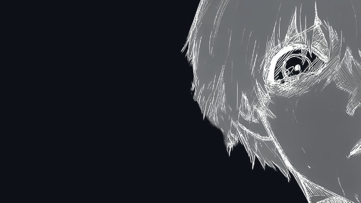
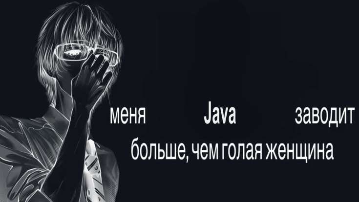

<picture>
  <source media="(prefers-color-scheme: dark)" srcset="media/header-dark.png">
  <source media="(prefers-color-scheme: light)" srcset="media/header-light.png">
  
</picture>

# Привет, я L1DRE

Главный программист команды FIRST Tech Challenge. Пишу код робота: автономка, траектории, управление системами.

Сейчас делаю робота на сезон BIOBUZZ 2026-27 — Java, Pedro Pathing, автоприцел башни. Код команды лежит в приватном репозитории.

Ещё интересуюсь алгоритмами, симуляцией движения, машинным обучением, кибербезопасностью и геймдевом. Помогаю младшим ребятам в команде разбираться в сложном.

> Мы — то, что делаем. Не бойся нарушать правила, если хочешь изменить мир.

<picture>
  <source media="(prefers-color-scheme: dark)" srcset="media/footer-dark.png">
  <source media="(prefers-color-scheme: light)" srcset="media/footer-light.png">
  
</picture>
