<!-- ctOS // L1DRE — панели в assets/ собирает scripts/build.py (обновляются раз в сутки) -->

<p align="center">
  
</p>

<p align="center">
  
</p>

<p align="center">
  <a href="https://github.com/L1DRE?tab=followers"></a>
  
</p>

<p align="center">
  
</p>

### `▌ whoami`

```console
┌──(gostname㉿L1DRE)-[~/ftc]
└─$ cat about.txt

  role ........ главный программист команды FIRST Tech Challenge
  does ........ автономка, траектории, управление системами робота
  stack ....... Java · C++ · Android SDK · Python
  into ........ алгоритмы, симуляция движения, машинное обучение
  side-ops .... кибербезопасность, геймдев
  mentor ...... раскладываю сложное на простое для младших ребят

└─$ echo $MOTTO
  «Мы — то, что делаем. Не бойся нарушать правила, если хочешь изменить мир.»
```

### `▌ ./arsenal`

<p>
  
  
  
  
  
  <br/>
  
  
  
  
</p>

### `▌ ls ~/ops`

| | операция | что внутри |
|:-:|---|---|
| `01` | [**FTC-integrate-PedroPathing-Visualizer**](https://github.com/L1DRE/FTC-integrate-PedroPathing-Visualizer) | визуализатор траекторий Pedro Pathing для FTC |
| `02` | [**ftc_fan_rule_site**](https://github.com/L1DRE/ftc_fan_rule_site) | фан-сайт с правилами FTC |
| `03` | [**Satoshi_FTC_Card**](https://github.com/L1DRE/Satoshi_FTC_Card) | карточка-хаб со ссылками команды |
| `04` | [**txt_generator_with_name**](https://github.com/L1DRE/txt_generator_with_name) | генератор текста по имени |

<p align="center">
  
</p>

<p align="center">
  
  <br/>
  <sub><em>«Да пребудет с вами сила!»</em></sub>
</p>
